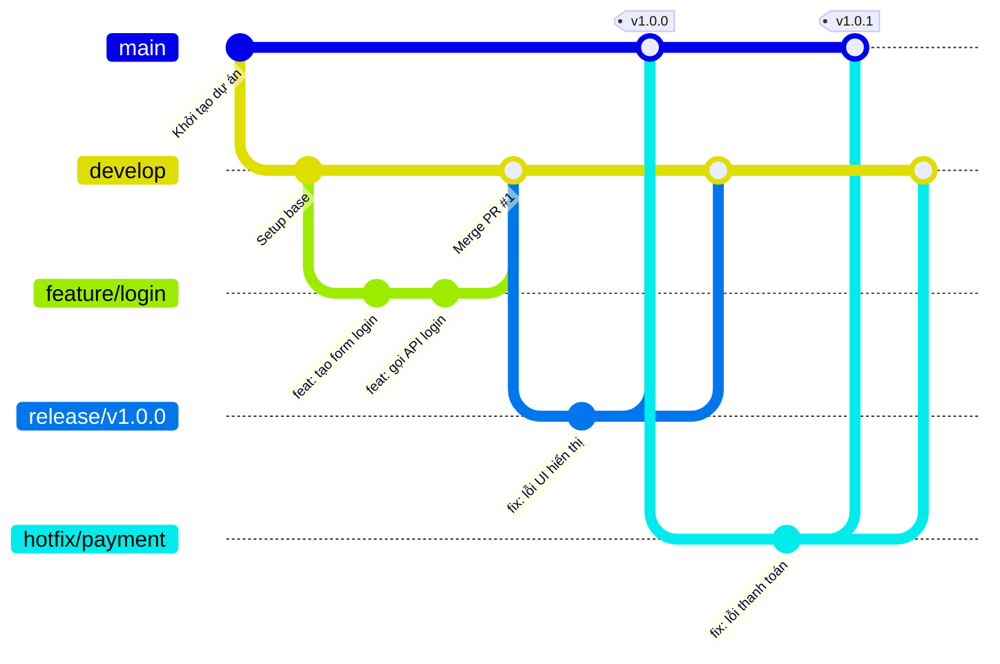

# Quy trình làm việc với Gitflow & GitHub Releases

Tài liệu này mô tả quy trình làm việc chuẩn với Git (dựa trên Gitflow) kết hợp với **Conventional Commits** để tự động hóa hoặc dễ dàng tạo Release Notes trên GitHub.

## 1. Các nhánh (Branches) cốt lõi



### Nhánh chính
- `main` (hoặc `master`): Chứa mã nguồn luôn ở trạng thái ổn định và sẵn sàng deploy lên môi trường Production.
- `develop`: Nhánh tích hợp chính cho các tính năng mới. Mã nguồn ở đây sẵn sàng để deploy lên môi trường Staging/Test.

### Nhánh hỗ trợ (Tạo ra và xóa đi sau khi merge)
- **Feature branches** (`feature/tên-tính-năng`): Nhánh để phát triển tính năng mới. Tách ra từ `develop` và merge lại vào `develop`.
- **Bugfix branches** (`bugfix/tên-lỗi`): Sửa các lỗi không nghiêm trọng trên môi trường develop/staging. Tách từ `develop` và merge lại vào `develop`.
- **Hotfix branches** (`hotfix/tên-lỗi-nghiêm-trọng`): Nhánh để sửa lỗi khẩn cấp trên Production. Tách ra từ `main`, sau khi sửa xong phải merge vào **CẢ** `main` và `develop`.
- **Release branches** (`release/vX.Y.Z`): Nhánh chuẩn bị cho một đợt release mới. Tách từ `develop`. Ở nhánh này chỉ fix bug, không thêm tính năng mới. Khi đã sẵn sàng, merge vào `main` và `develop`.

---

## 2. Quy ước đặt tên Commit (Conventional Commits)

Việc viết commit message đúng chuẩn là **BẮT BUỘC** vì nó là cơ sở để GitHub sinh ra Release Notes tự động một cách đẹp mắt.

**Cú pháp:** `<type>(<scope>): <subject>`

**Các `<type>` phổ biến:**
- `feat`: Thêm một tính năng mới (Sẽ xuất hiện trong mục *Features* của Release Note).
- `fix`: Sửa lỗi (Sẽ xuất hiện trong mục *Bug Fixes* của Release Note).
- `docs`: Cập nhật tài liệu (README, CHANGELOG...).
- `style`: Định dạng code, thiếu dấu phẩy... không ảnh hưởng logic.
- `refactor`: Cải thiện cấu trúc code, không thêm tính năng hay sửa lỗi.
- `perf`: Cải thiện hiệu năng.
- `test`: Thêm hoặc sửa test case.
- `chore`: Cập nhật build task, cấu hình package manager, dọn dẹp...

**Ví dụ:**
- `feat(journal): thêm chức năng lưu nháp nhật ký`
- `fix(auth): sửa lỗi không thể đăng nhập bằng Google`
- `docs(readme): cập nhật hướng dẫn cài đặt`

*(Dự án của chúng ta đã có file `docs/CONVENTIONAL_COMMITS.md` để tham khảo chi tiết hơn).*

---

## 3. Quy trình làm việc (Workflow) từng bước

### Bước 1: Bắt đầu một tính năng mới (Feature)
1. Đảm bảo nhánh `develop` đang ở trạng thái mới nhất:
   ```bash
   git checkout develop
   git pull origin develop
   ```
2. Tạo nhánh feature mới:
   ```bash
   git checkout -b feature/user-profile
   ```
3. Code, commit với quy ước Conventional Commits, và push:
   ```bash
   git add .
   git commit -m "feat(profile): thiết kế giao diện trang cá nhân"
   git push origin feature/user-profile
   ```
4. Lên GitHub, tạo **Pull Request (PR)** từ nhánh `feature/user-profile` vào nhánh `develop`.
5. Review code và Merge PR (Nên dùng tùy chọn *Squash and merge* để giữ lịch sử commit sạch sẽ).

### Bước 2: Chuẩn bị Release (Release)
Khi nhánh `develop` đã gom đủ các tính năng cho một phiên bản mới:
1. Tạo nhánh release từ `develop`:
   ```bash
   git checkout develop
   git pull origin develop
   git checkout -b release/v1.2.0
   ```
2. Cập nhật version trong `package.json`, chạy test, fix các bug nhỏ (chỉ commit fix bug, không commit feat).
3. Push nhánh release lên GitHub:
   ```bash
   git push origin release/v1.2.0
   ```
4. Tạo **Pull Request** từ `release/v1.2.0` vào nhánh `main`.
5. Review và Merge vào `main` (Dùng tùy chọn *Merge commit*).
6. **QUAN TRỌNG:** Phải merge ngược nhánh `release/v1.2.0` về lại `develop` để đồng bộ các bug fix (nếu có):
   - Tạo PR từ `release/v1.2.0` vào `develop`.

### Bước 3: Tạo GitHub Release & Tags
Sau khi mã đã được merge vào `main`:
1. Chuyển sang nhánh `main` và kéo code mới nhất về:
   ```bash
   git checkout main
   git pull origin main
   ```
2. Lên giao diện GitHub, vào phần **Releases** -> **Draft a new release**.
3. **Choose a tag:** Nhập tên tag (VD: `v1.2.0`) và chọn tạo mới tag này từ nhánh `main`.
4. **Release title:** Nhập tên phiên bản (VD: `Release v1.2.0`).
5. **Release Notes:** Bấm nút **Generate release notes**. 
   *Lưu ý quan trọng:* Để GitHub tự động phân loại các tính năng (`feat`) và sửa lỗi (`fix`) một cách chính xác vào các mục riêng biệt trong Release Note, dự án cần cấu hình file `.github/release.yml` (đã được tạo sẵn trong dự án). GitHub sẽ đọc Pull Request titles theo chuẩn Conventional Commits để tự động tạo báo cáo.
6. Publish release.

### Bước 4: Xử lý sự cố khẩn cấp (Hotfix)
Khi có lỗi nghiêm trọng trên Production (`main`):
1. Tạo nhánh hotfix từ `main`:
   ```bash
   git checkout main
   git pull origin main
   git checkout -b hotfix/payment-crash
   ```
2. Sửa lỗi, commit:
   ```bash
   git commit -m "fix(payment): sửa lỗi crash khi thanh toán bằng thẻ"
   ```
3. Push lên GitHub và tạo **2 Pull Requests** (Lưu ý: **Không** cần tạo nhánh `release` cho Hotfix, chúng ta merge thẳng vào `main`):
   - PR 1: `hotfix/payment-crash` -> `main`
   - PR 2: `hotfix/payment-crash` -> `develop` (Để đảm bảo các bản release sau không bị dính lại lỗi này. *Lưu ý: Nếu đang có một nhánh `release` đang mở, phải merge hotfix vào nhánh `release` đó thay vì `develop`*).
4. Merge cả 2 PR. 
5. Ngay sau khi merge vào `main`, thực hiện lại **Bước 3** để tạo Tag và GitHub Release mới (Tăng version Patch, VD: từ `v1.2.0` lên `v1.2.1`).

---

## 4. Tổng kết các Rule cần nhớ
- **Tuyệt đối không commit trực tiếp vào `main` và `develop`.**
- **Luôn sử dụng Pull Request** để code được review.
- **Tuân thủ chặt chẽ Conventional Commits** để GitHub có thể tạo Release Notes tự động.
- Khi làm Hotfix hoặc Release, **luôn nhớ merge ngược về `develop`**.